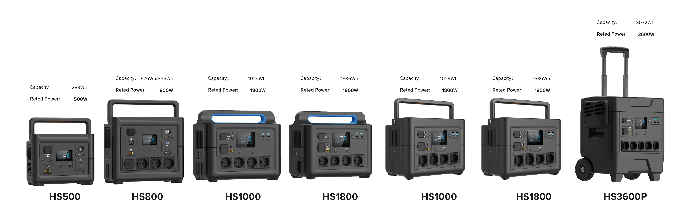
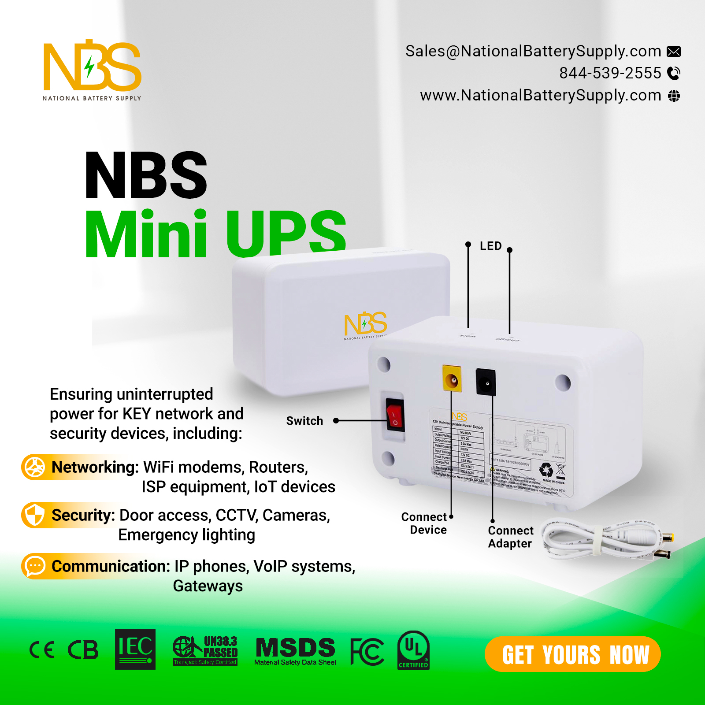

# Battery Marketing Images | LiFePO4, UPS, Portable Power & Energy Storage

**National Battery Supply's battery and backup power image library** for product marketing, industry campaigns, and commercial energy solutions.

**Project homepage (GitHub Pages, available after Pages is enabled):** https://national-battery-supply.github.io/Battery-Marketing-Images/  
**Official company website:** [NationalBatterySupply.com](https://nationalbatterysupply.com/) · **[Browse all repository files](https://github.com/National-Battery-Supply/Battery-Marketing-Images)**

## Image previews

These are actual marketing visuals from this repository. Select an image to open its source file.

| Portable power stations | Mini UPS battery backup | 5G telecom battery systems |
| :---: | :---: | :---: |
| [](Portable-Power-Stations.jpg) | [](NBS-Mini-UPS-battery-backup.jpg) | [](5g%20Telecom%20Battery-promo-2.jpg) |

## Quick start

**Browse online:** Open the [image library](https://github.com/National-Battery-Supply/Battery-Marketing-Images) and select any PNG or JPG to preview or download it.

**Clone the assets locally:**

```bash
git clone https://github.com/National-Battery-Supply/Battery-Marketing-Images.git
cd Battery-Marketing-Images
```

**Embed an image in a webpage or approved marketing preview:**

```html

```

> **Usage note:** Public viewing or cloning does not grant permission to reuse branded images in third-party marketing. [Contact National Battery Supply](https://nationalbatterysupply.com/contact-us/) for authorized commercial use.

## Common use cases

- **B2B sales and procurement:** Visual references for bulk battery sourcing, OEM/ODM programs, and supplier presentations.
- **Telecommunications and IT:** Marketing illustrations for 5G base stations, telecom cabinets, data centers, and UPS applications.
- **Hospitality and healthcare:** Examples of battery backup messaging for Wi-Fi, medical systems, and senior living facilities.
- **Industrial and fleet operations:** Visual assets relating to LiFePO4 forklift batteries, custom packs, and deep-cycle energy systems.
- **Portable and emergency power:** Creative assets for portable power stations, marine power, and hurricane-preparedness campaigns.

## About

Battery marketing images for LiFePO4, portable power, mini UPS, telecom, data centers, and OEM battery solutions.

This repository collects National Battery Supply promotional images and product-focused visuals for battery technology, backup power, and energy storage applications. It is an **image and marketing asset library**, not a source-code package, hardware specification database, or open image license.

## Explore the image library

### Portable power and emergency preparedness

- [Portable power stations](Portable-Power-Stations.jpg)
- [Additional portable power station visual](portable-power-stations-1.png)
- [Portable power station campaign](portable-power-stations-3.png)
- [Hurricane preparedness visual](NBS-Hurricane-Promo.jpg)
- [Portable power flyer (PDF)](NBS-Portable-Power-Flyer-5-12-25.pdf)

### Mini UPS and critical infrastructure

- [Mini UPS battery backup](NBS-Mini-UPS-battery-backup.jpg)
- [Additional mini UPS visual](NBS-Mini-UPS-battery-backup-2.jpg)
- [Mini UPS backup image (PNG)](NBS-mini-UPS-battery-backup.png)
- [Data center battery backup](data-center-battery-backup.png)
- [Traffic intersection UPS backup](UPS-battery-backup-for-traffic-intersection.jpg)

### Telecommunications, hospitality, and healthcare

- [5G telecom battery promotional image](5g%20Telecom%20Battery-promo-1.jpg)
- [Telecom cabinet power systems](Telecom%20Cabinet.png)
- [Deep-cycle telecommunications batteries](Deep-cycle-battery-telecommunications.png)
- [Hotel Wi-Fi power](Hotel%20Wifi.png)
- [Medical and hospital battery backup](medical-hospital-battery-backup.png)
- [Senior living power applications](Senior%20Living.png)

### Custom batteries, industrial power, and energy storage

- [Custom Li-ion and LiFePO4 battery packs](custom-battery-packs-lithium-ion-lifepo4.png)
- [Custom battery campaign visual](Custom%20Batteries_UPDATED.png)
- [LiFePO4 forklift battery supply](LiFePO4-forklift-battery-supply.png)
- [Marine LiFePO4 batteries](LIFEPO4-Marine-Battery.png)
- [AGM batteries](NBS-AGM-Batteries.jpg)
- [Solar battery backup](solar-battery-backup.png)

### Sourcing, procurement, and channel partners

- [Battery sourcing image](Battery%20Sourcing_UPDATED.png)
- [Procurement team image](Procurement%20Team_UPDATED.png)
- [MSP dealer program image](NBS-dealer-program-for-MSPs.png)

**[View the complete repository and remaining campaign images →](https://github.com/National-Battery-Supply/Battery-Marketing-Images)**

## Suggested GitHub About description

> Battery marketing images for LiFePO4, portable power, mini UPS, telecom, data centers, and OEM battery solutions.

*Short enough for GitHub's repository description field (under 120 characters).*

## Recommended GitHub topic tags

`batteries` · `lifepo4` · `lithiumbattery` · `batterybackup` · `energystorage` · `portablepower` · `ups` · `miniups` · `telecom` · `datacenter` · `custombattery` · `oem` · `batteryimages` · `productmarketing` · `batterytechnology`

*Add these through the repository's **About → Topics** editor; listing them here does not automatically configure GitHub topics.*

## Image usage and inquiries

These files are provided as National Battery Supply marketing references. Product details and availability should be confirmed directly with our team. No third-party commercial reuse rights are granted by this README.

---

### Need battery pricing, custom battery packs, or reliable backup power?

**National Battery Supply** supports bulk battery purchasing, OEM/ODM battery solutions, portable power, UPS backup, and commercial energy storage requirements.

**[Visit NationalBatterySupply.com](https://nationalbatterysupply.com/) · [Contact us for a quote](https://nationalbatterysupply.com/contact-us/) · [Email Sales@NationalBatterySupply.com](mailto:Sales@NationalBatterySupply.com)**

Tell us your battery requirements, application, approximate quantities, or existing part numbers so our team can discuss suitable options and volume pricing.
